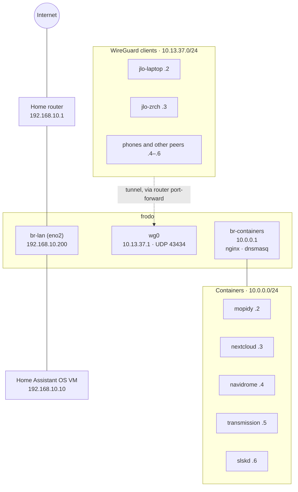
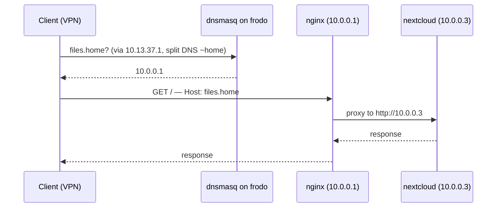

# dotfiles

These are my dotfiles. They are messy.

This is a NixOS flake covering several hosts (`jlo-zrch`, `jlo-laptop`, `frodo`,
see `flake.nix`). `system/` and `modules/` hold shared config behind feature flags
(`my.features.*`), `hosts/<name>/` holds per-host config, `hardware/<name>.nix` holds
the machine-generated hardware config, and `home/` holds home-manager config shared
across hosts.

## Network

frodo is the home server and sits on three networks at once:

- **Home LAN `192.168.10.0/24`** — frodo's physical NIC `eno2` is enslaved to the
  bridge `br-lan`, which holds frodo's LAN address `192.168.10.200`. The Home
  Assistant OS VM (Incus, `hosts/frodo/terraform/`) is attached straight to
  `br-lan` as `192.168.10.10`, so it's a regular LAN device — Matter/Thread and
  companion-app discovery need link-local multicast, which wouldn't cross NAT.
- **Container network `10.0.0.0/24`** — the bridge `br-containers` (frodo is
  `10.0.0.1`) connects the NixOS containers (`hosts/frodo/containers/`). frodo
  NATs their outbound traffic through `br-lan`.
- **WireGuard `10.13.37.0/24`** — frodo's `wg0` (`10.13.37.1`, UDP 43434) is the
  VPN server; laptops and phones are clients. The home router forwards UDP 43434
  to frodo so clients can connect from outside.



### DNS and HTTP services

frodo's dnsmasq (`hosts/frodo/services.nix`) listens on all three of frodo's
addresses and resolves every `*.home` name to `10.0.0.1`, where nginx routes by
hostname to the right container (or to Home Assistant on the LAN). Everything
else is forwarded upstream to 1.1.1.1 / 8.8.8.8.

WireGuard clients send only `*.home` lookups to frodo (split DNS: the WireGuard
module sets `resolvectl domain wg0 "~home"` on clients). Because those names
resolve to `10.0.0.1`, a client's `allowedIPs` for frodo must include
`10.0.0.0/24` as well as `10.13.37.0/24`. LAN devices don't use frodo for DNS
yet, since the router still hands out its own resolver.



| Name                 | Proxied to              |
|----------------------|-------------------------|
| `files.home`         | nextcloud `10.0.0.3`    |
| `mopidy.home`        | mopidy `10.0.0.2:6680`  |
| `navidrome.home`     | navidrome `10.0.0.4:4533` |
| `transmission.home`  | transmission `10.0.0.5:9091` |
| `slskd.home`         | slskd `10.0.0.6:5030`   |
| `homeassistant.home` | HAOS `192.168.10.10:8123` |

To add a service: give the container the next free `10.0.0.x` address in
`hosts/frodo/containers/default.nix`, then add both a dnsmasq `address` entry and
an nginx virtual host in `hosts/frodo/services.nix`.

## Bootstrapping a new machine

### 1. Boot the installer and get network access

Boot a NixOS installer ISO. Wired networking usually just works. For WiFi, the
installer ISO ships NetworkManager, so the easiest path is:

```
sudo nmcli device wifi connect "<SSID>" password "<password>"
```

If NetworkManager isn't available, fall back to `wpa_supplicant` directly:

```
sudo wpa_supplicant -B -i wlan0 -c <(wpa_passphrase "<SSID>" "<password>")
sudo dhcpcd wlan0   # or: sudo udhcpc -i wlan0
```

(`wlan0` may differ — check `ip link` for the wireless interface name.)

Clone this repo somewhere writable, e.g. `/mnt/etc/nixos/dotfiles` won't exist yet
since nothing is mounted — clone it to `/tmp/dotfiles` or similar for now and move
it into place after disko mounts `/mnt`.

### 2. Add the new host to the flake

Pick a hostname (`<name>`) and add:

- `hosts/<name>/default.nix` — see any existing host dir for the shape. At minimum
  you need `config.my.username`, `hostName`, `stateVersion`, `homeStateVersion`,
  and `disks.device` (the target disk, e.g. `/dev/nvme0n1`; add `disks.swap` for a
  swap partition size, e.g. `"8G"`). Feature flags (`config.my.features.*`) turn on
  optional shared config — grep `options\.my\.` across the repo for the current
  list (desktop, audio, bluetooth, greeter, postgres, printing, sleep,
  virtualisation, yubikey, zsaKeyboard, onyxBoox, and more); most default to off
  except `desktop`, which defaults to on.
- `hardware/<name>.nix` — a temporary placeholder for now, e.g.:
  ```nix
  { ... }: { }
  ```
  This gets overwritten with the real machine-generated config in step 4.
- An entry in `flake.nix`'s `nixosConfigurations`, following the existing
  `mkHost { hardware = ./hardware/<name>.nix; host = ./hosts/<name>; }` pattern.

Commit or at least `git add` these — an **untracked** file is invisible to the
flake (you'll get a "not tracked by Git" eval error), so `git add` new files
before evaluating, even if you don't commit yet.

### 3. Partition the disk with disko

From the installer, with the repo cloned and the host wired up as above:

```
sudo nix --extra-experimental-features "nix-command flakes" run github:nix-community/disko -- \
  --mode disko --flake path:/tmp/dotfiles#<name>
```

This partitions, formats, and mounts everything under `/mnt` according to
`system/disko.nix` (a single GPT disk: EFI boot partition, ext4 root, optional
swap at the end).

### 4. Generate the real hardware config

```
sudo nixos-generate-config --no-filesystems --root /mnt
```

(`--no-filesystems` since disko already declares filesystems declaratively —
without it you'd get conflicting `fileSystems` entries.) Copy the generated
`/mnt/etc/nixos/hardware-configuration.nix` content into `hardware/<name>.nix` in
the repo, replacing the placeholder from step 2, `git add` it.

### 5. Install

```
sudo mkdir -p /mnt/etc/nixos
sudo cp -r /tmp/dotfiles /mnt/etc/nixos/dotfiles
sudo nixos-install --flake /mnt/etc/nixos/dotfiles#<name>
```

`system/users.nix` sets `initialHashedPassword = ""`, so the user account starts
with no usable password — set one before rebooting:

```
sudo nixos-enter --root /mnt -c 'passwd <username>'
```

Reboot into the new system.

### 6. Set up sops-nix secrets for the new host

Each host needs its own age key and its own `secrets/<name>.yaml` before any
secret can actually decrypt there.

Two kinds of key are involved, and they're deliberately different things:

- **Your personal age key** (`~/.config/sops/age/keys.txt`, generated once with
  `age-keygen`) — lets *you* open and edit any host's secrets file from your own
  workstation.
- **Each host's own age key** (`/var/lib/sops-nix/key.txt` *on that host*) — lets
  the host decrypt its own secrets automatically at boot/activation. One per
  host, never shared between hosts.

Every `secrets/<host>.yaml` gets encrypted for both: your personal key (so you
can always edit it) and that host's key (so it can always decrypt it).

Steps for a new host:

1. If you don't already have a personal key: `age-keygen -o
   ~/.config/sops/age/keys.txt`.
2. Add a `path_regex` entry for `secrets/<name>\.yaml$` to `.sops.yaml`, with your
   personal key as the only recipient for now (the host's key doesn't exist yet).
3. Create the file and fill in real values by hand, so plaintext secrets never
   need to leave your editor: `sops secrets/<name>.yaml`.
4. Reference it from the host config: `config.sops.defaultSopsFile =
   ../../secrets/<name>.yaml;`, plus a `sops.secrets.<key> = {};` for each secret
   you need, pointed at from wherever it's consumed (see `hosts/jlo-zrch/default.nix`
   or `hosts/frodo/network.nix` for examples of feeding a decrypted secret into
   another option via `config.sops.secrets.<key>.path`).
5. Rebuild (`sudo nixos-rebuild switch --flake .#<name>`). **This first rebuild is
   expected to report an error** on the `setupSecrets` activation step — the
   host's key gets generated by `generate-age-key`, which only ever runs
   alongside actual secret installation (it's gated behind `sops.secrets != {}`
   in sops-nix's own module), so on this very first pass the key is brand new
   and the secrets file isn't encrypted for it yet. The key still gets written
   to disk despite the reported failure.
6. `sudo age-keygen -y /var/lib/sops-nix/key.txt` to print the new host's public
   key. Add it to `.sops.yaml` as a recipient for that host's `path_regex`.
7. Re-encrypt for the updated recipient list (no need to touch the plaintext
   again): `sops updatekeys secrets/<name>.yaml`.
8. Rebuild once more — it should decrypt cleanly this time.

### 7. Join the WireGuard mesh (if this host needs VPN access)

frodo is the current WireGuard server (`hosts/frodo/network.nix`). Add a peer
entry there — `publicKey` + `allowedIPs` for the new host — and set the new host
up as a client (see `hosts/jlo-laptop/default.nix` for the client-side shape:
`peerType = "client"`, an `endpoint` pointing at the server, and its own
`privateKeyFile`/sops secret as in step 6 above).

### 8. Terraform (only for hosts that use it, e.g. frodo/Incus)

Run locally on the host itself — it talks to the local Incus socket by default:

```
cd hosts/<name>/terraform
terraform init
terraform apply
```

### 9. Server SSH access

Servers have hardcoded lists of authorized ssh keys, under
`users.users.<name>.openssh.authorizedKeys.keys`.
